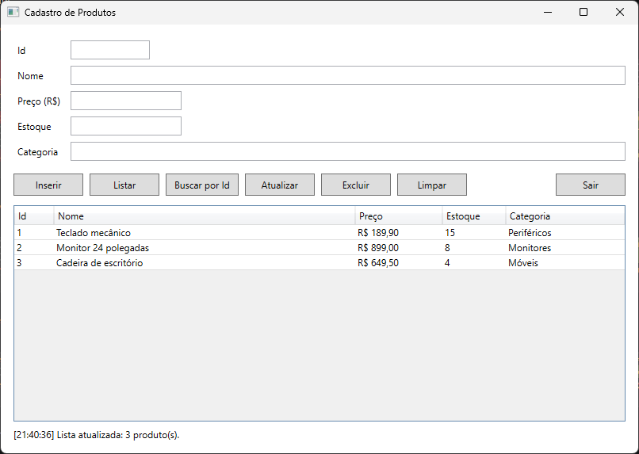
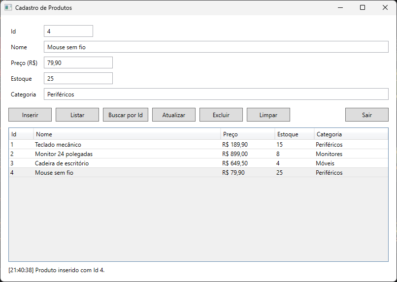
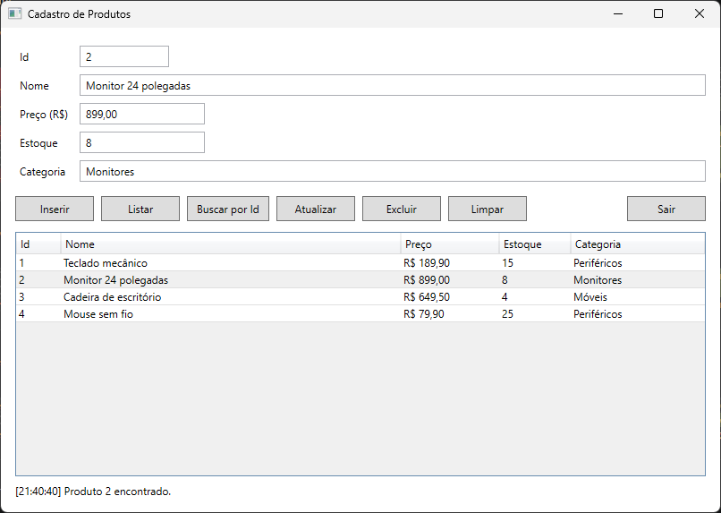
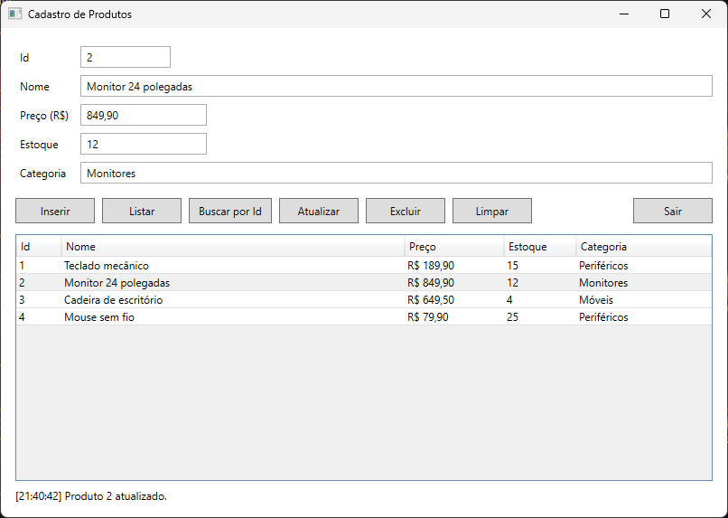
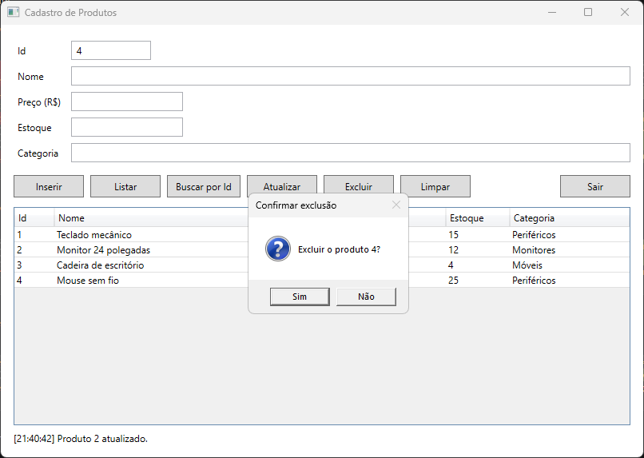
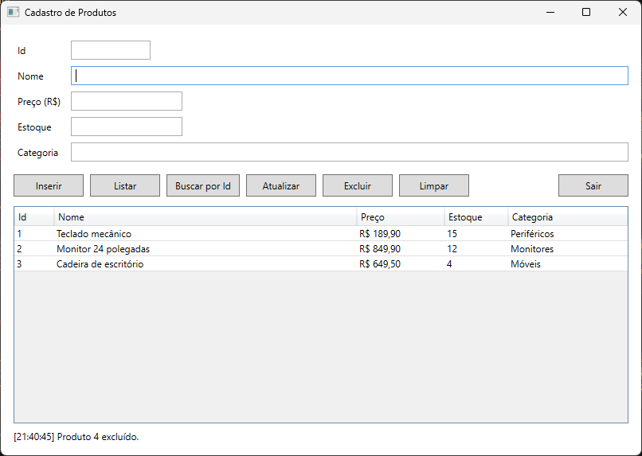
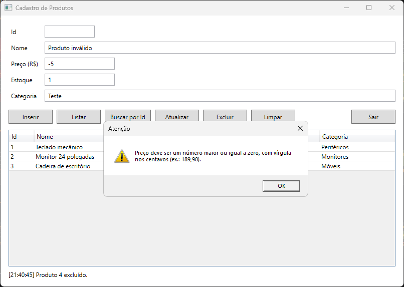

# C# Checkpoint 5 - CRUD com ADO.NET: Cadastro de Produtos

Aplicação WPF em C# (.NET 8) para cadastrar e gerenciar produtos. O acesso ao banco SQLite é feito com ADO.NET puro (`Microsoft.Data.Sqlite`): conexão, comandos parametrizados, `ExecuteNonQuery`, `ExecuteReader` e mapeamento manual do `DataReader` para objetos `Produto`. Não usa Entity Framework nem Dapper.

**Dupla:**

- Weslley Cardoso - RM 557927 - turma 3ESPZ
- Fernando Navajas - RM 555080

## Funcionalidades

O menu do enunciado virou a linha de botões da janela:

| Menu do enunciado | Botão | Método do `ProdutoRepository` |
| --- | --- | --- |
| 1. Inserir produto | Inserir | `Inserir` |
| 2. Listar produtos | Listar (o grid também carrega ao abrir) | `Listar` |
| 3. Buscar produto por ID | Buscar por Id | `BuscarPorId` |
| 4. Atualizar produto | Atualizar | `Atualizar` |
| 5. Excluir produto | Excluir (pede confirmação) | `Excluir` |
| 6. Sair | Sair | - |

Clicar numa linha do grid preenche o formulário. O campo Id é a chave usada por Buscar, Atualizar e Excluir. O botão Limpar esvazia o formulário.

## Pré-requisitos

- Windows (WPF só roda no Windows)
- [.NET SDK 8](https://dotnet.microsoft.com/download) ou mais recente. O projeto aceita rodar num runtime mais novo se o 8 não estiver instalado.
- Ou o Visual Studio 2022 (ou mais recente) com a carga de trabalho "Desenvolvimento para desktop com .NET", que já traz o SDK.

Não é preciso instalar banco de dados: o SQLite vem no pacote NuGet `Microsoft.Data.Sqlite`.

## Como executar

### Pelo terminal

```bash
git clone https://github.com/Carti011/checkpoint5-produtos.git
cd checkpoint5-produtos
dotnet run --project Produtos.App
```

### Pelo Visual Studio

1. Menu **Git > Clonar Repositório**, cole `https://github.com/Carti011/checkpoint5-produtos.git` e clique em **Clonar**. Se o projeto já estiver na máquina, abra o arquivo `CheckpointProdutos.sln`.
2. Espere a barra de status, no canto inferior esquerdo, terminar "Restaurando pacotes do NuGet".
3. Na barra de ferramentas, com `Produtos.App` selecionado, clique no botão verde de executar (F5). Para rodar sem o depurador, use Ctrl+F5.

Na primeira execução o arquivo `produtos.db` ainda não existe. A aplicação cria o banco rodando o script [banco/criar-tabela-produtos.sql](banco/criar-tabela-produtos.sql), que cria a tabela `Produtos` e insere 3 produtos de exemplo. Nas execuções seguintes o banco é reaproveitado. Para voltar ao estado inicial, apague o `produtos.db`.

## Configuração

A connection string fica em [Produtos.App/appsettings.json](Produtos.App/appsettings.json):

```json
{
  "ConnectionStrings": {
    "Produtos": "Data Source=produtos.db"
  }
}
```

O `App.xaml.cs` lê o arquivo com `Microsoft.Extensions.Configuration.Json` e passa a connection string para o construtor do `ProdutoRepository`. O caminho relativo é resolvido a partir da pasta do executável, então o banco (`produtos.db`) e o log (`log.txt`) ficam sempre em `Produtos.App/bin/Debug/net8.0-windows/`, rodando pelo `dotnet run` ou pelo Visual Studio.

## Estrutura

```text
checkpoint5-produtos/
├── CheckpointProdutos.sln
├── banco/
│   └── criar-tabela-produtos.sql   cria a tabela Produtos e insere 3 produtos de exemplo
├── Produtos.App/                   aplicação WPF
│   ├── Produto.cs                  classe Produto
│   ├── ProdutoRepository.cs        todo o acesso ao banco (único arquivo com SQL)
│   ├── Log.cs                      registro das operações em log.txt
│   ├── MainWindow.xaml(.cs)        janela: formulário, botões, grid e validações
│   ├── App.xaml(.cs)               lê o appsettings.json e cria o banco na primeira execução
│   └── appsettings.json            connection string
├── Produtos.Testes/                testes unitários (xUnit) do ProdutoRepository
└── imagens/                        prints das operações
```

Separação entre interface e acesso a dados: a janela (`MainWindow.xaml.cs`) só valida a entrada e chama os métodos do `ProdutoRepository`. Nenhuma string SQL aparece fora do repositório.

## Onde está cada requisito

| Requisito | Onde |
| --- | --- |
| Conexão com o banco via ADO.NET | `SqliteConnection` em cada método de [ProdutoRepository.cs](Produtos.App/ProdutoRepository.cs) |
| Script `.sql` da tabela | [banco/criar-tabela-produtos.sql](banco/criar-tabela-produtos.sql) |
| Connection string no `appsettings.json` | [appsettings.json](Produtos.App/appsettings.json), lida em [App.xaml.cs](Produtos.App/App.xaml.cs) |
| Classe `Produto` | [Produto.cs](Produtos.App/Produto.cs) |
| Classe `ProdutoRepository` com `Inserir`, `Listar`, `BuscarPorId`, `Atualizar` e `Excluir` | [ProdutoRepository.cs](Produtos.App/ProdutoRepository.cs) |
| `ExecuteNonQuery` em INSERT, UPDATE e DELETE | `Inserir`, `Atualizar` e `Excluir`. O `Inserir` lê em seguida o Id gerado com `SELECT last_insert_rowid()` |
| `ExecuteReader` nas consultas SELECT | `Listar` e `BuscarPorId` |
| Mapeamento manual do `DataReader` para `Produto` | método `Mapear` do `ProdutoRepository` |
| Comandos parametrizados em todas as operações | parâmetros `@nome`, `@preco`, `@estoque`, `@categoria` e `@id` |
| Tratamento de exceções do banco | `catch (SqliteException)` em cada método do repositório; mensagem em `MessageBox` na janela |
| Registro das operações em arquivo | [Log.cs](Produtos.App/Log.cs), gravando em `log.txt` |
| Menu com as 6 opções | botões da [MainWindow.xaml](Produtos.App/MainWindow.xaml) |
| Bônus: testes unitários | [ProdutoRepositoryTestes.cs](Produtos.Testes/ProdutoRepositoryTestes.cs) |

## SQL parametrizado e SQL Injection

Todos os comandos usam parâmetros, sem concatenação nem interpolação de string no SQL. Trecho real do método `Inserir`:

```csharp
comando.CommandText = """
    INSERT INTO Produtos (Nome, Preco, Estoque, Categoria)
    VALUES (@nome, @preco, @estoque, @categoria)
    """;
comando.Parameters.AddWithValue("@nome", produto.Nome);
comando.Parameters.AddWithValue("@preco", produto.Preco);
comando.Parameters.AddWithValue("@estoque", produto.Estoque);
comando.Parameters.AddWithValue("@categoria", produto.Categoria);
comando.ExecuteNonQuery();
```

Por que isso impede a injeção: o SQLite compila o comando com os marcadores `@nome`, `@preco` e os demais, e os valores chegam depois, separados do comando, sempre tratados como dados. O que o usuário digita nunca vira parte do código SQL.

Se o nome fosse concatenado na string, um nome como `x', 0, 0, 'x'); DROP TABLE Produtos; --` fecharia o `VALUES` e executaria um `DROP TABLE` logo depois. Com parâmetro, esse texto é gravado literalmente como nome do produto e a tabela continua intacta. Um dos testes unitários prova isso. Buscar, atualizar e excluir usam `WHERE Id = @id` do mesmo jeito.

## Tratamento de erros e log

- Cada método do `ProdutoRepository` tem `try/catch (SqliteException)`. O erro técnico vai para o `log.txt` e o método lança uma exceção com mensagem limpa, como "Não foi possível inserir o produto.".
- A janela captura essa exceção e mostra a mensagem num `MessageBox`. O detalhe técnico nunca aparece na tela.
- Antes de chamar o repositório, a janela valida a entrada: nome e categoria obrigatórios, preço e estoque numéricos e não negativos. O preço é digitado com vírgula (`189,90`).
- Toda operação, com sucesso ou com erro, é registrada em `log.txt`, uma linha por operação:

```text
[2026-09-30 21:40] Banco criado pelo script criar-tabela-produtos.sql
[2026-09-30 21:40] Produtos listados - 3 registro(s)
[2026-09-30 21:40] Produto inserido - Id=4, Nome=Mouse sem fio
[2026-09-30 21:40] Produto encontrado - Id=2, Nome=Monitor 24 polegadas
[2026-09-30 21:40] Produto atualizado - Id=2, Nome=Monitor 24 polegadas
[2026-09-30 21:40] Produto excluído - Id=4
[2026-09-30 21:40] Produto não encontrado - Id=999
```

## Testes unitários (bônus)

Os testes estão no projeto `Produtos.Testes` (xUnit), no arquivo [Produtos.Testes/ProdutoRepositoryTestes.cs](Produtos.Testes/ProdutoRepositoryTestes.cs). Cada teste cria um banco SQLite temporário com o mesmo script da aplicação e apaga o arquivo no fim.

| Teste | O que prova |
| --- | --- |
| `Inserir_e_BuscarPorId_devolvem_o_mesmo_produto_com_preco_decimal_intacto` | inserção e busca por Id; o preço `189,90` volta igual com a cultura pt-BR |
| `Listar_devolve_os_produtos_inseridos` | listagem |
| `Atualizar_altera_os_campos` | atualização de todos os campos |
| `Excluir_remove_e_BuscarPorId_passa_a_devolver_null` | exclusão |
| `Inserir_com_sql_injection_no_nome_grava_o_texto_literal_e_a_tabela_sobrevive` | dois nomes maliciosos (`'; DROP TABLE Produtos; --` e `x', 0, 0, 'x'); DROP TABLE Produtos; --`) são gravados literalmente e a tabela continua existindo |

Para rodar, na raiz do repositório:

```bash
dotnet test
```

No Visual Studio: menu **Teste > Gerenciador de Testes** e depois **Executar Todos os Testes** (Ctrl+R, A).

Resultado esperado: 6 testes aprovados (5 métodos; o de injeção roda com 2 entradas).

## Prints

**Listar:** lista com os 3 produtos criados pelo script.



**Inserir:** produto inserido com Id 4 e selecionado no grid.



**Buscar por Id:** a busca do Id 2 preenche o formulário.



**Atualizar:** preço e estoque do Id 2 alterados.



**Excluir:** confirmação e resultado.





**Validação:** preço negativo bloqueado antes de chegar ao banco.


